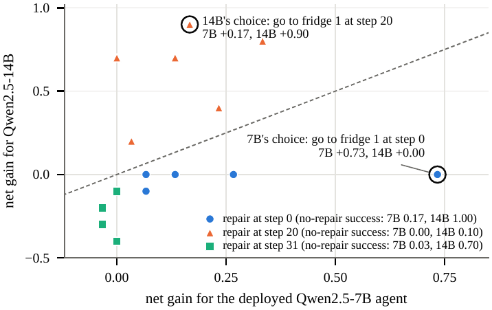

# Repairs for Whom?

**Evaluator–Executor Mismatch in Selecting Repairs for Failed LLM Agents**

Yijun Liao, Fanwei Liang

[Paper (arXiv:2610.38610)](https://arxiv.org/abs/2610.38610) · [Data index](docs/DATA_INDEX.md) · [Evaluation protocol](framework/docs/PROTOCOL.md) · [Analysis plan](analysis_plan/README.md) · [Release status](docs/RELEASE_STATUS.md)

When an LLM agent fails, repair methods choose which action to replace and what to put in its place. They usually score candidate repairs with greedy replay, a stronger model, an environment oracle, or a judge that reads the failed log. This repository asks whether those evaluators pick repairs that help the agent that will actually execute them. It contains the code, failed trajectories, fixed candidate repairs, every individual continuation outcome, the dated analysis plan, and a reusable CPU evaluation framework.

<p align="center">
  
</p>
<p align="center"><em>One failed ALFWorld trajectory: the 7B agent's best repair is worth nothing to the 14B model, and the 14B model's favourite is worth little to the 7B agent.</em></p>

## Main findings

Failed trajectories and candidate single-step repairs are held fixed; every candidate is labelled with independent rollouts of the deployed policy, and each evaluator is scored by the deployment value its choices lose (cross-fitted, trajectory-level bootstrap, pre-specified tests with Holm correction).

- **Substitute evaluators lose deployment value.** On failures not screened for repair value, greedy replay loses 0.08–0.13 in net success gain in ALFWorld and 0.06–0.13 in net reward in WebShop, relative to selection with the deployed agent's own rollouts.
- **A stronger model is a different executor.** At an equal rollout budget, selecting repairs for Qwen2.5-7B with Qwen2.5-14B rollouts loses 0.25 in ALFWorld and 0.07 in WebShop. Twenty 14B rollouts per candidate are worth no more than two of the 7B agent's own, and fresh rollouts confirm opposite preferences on selected disagreement cases.
- **So is the agent after training.** After one round of fine-tuning on verified repairs, the agent's own successors lose 0.55–0.60 when they select repairs for the agent they were trained from; for a second pair, trained on labels chosen without the planner's candidates, a pre-specified test confirms this for both seeds.
- **Relative to what selection is worth,** substitute models forgo 11–53%. On τ²-bench, where selecting is worth only about 0.10, the loss is 0.03; that pool did not pass its positive control and is reported as a bound.

Repairs should be verified with the executor that will run them, and repair labels should name their executor, including its training version.

## Quick start: reproduce the primary results on CPU

Python 3.10+, from the repository root:

```bash
python -m pip install -r requirements-offline.txt
python tools/verify_release.py          # SHA256 check of every released file
cd framework
python -m repair_eval validate data/alfworld-q7
python -m repair_eval reproduce         # recomputes the primary tests from individual outcomes
```

`reproduce` checks the four primary unscreened pools against archived reference records and writes reports to `framework/outputs/reproduction/`. It needs no model weights, GPU, ALFWorld or WebShop installation. Commands for the τ²-bench and successor analyses are in [REPRODUCING.md](docs/REPRODUCING.md).

## Data

| Pool | Deployed agent | Failures | Candidate repairs | Continuation executors (rollouts per branch) | Location |
|---|---|---:|---:|---|---|
| ALFWorld | Qwen2.5-7B-Instruct | 60 | 1,106 | Qwen 7B (10), Qwen 14B (20), Llama 8B (10) | `framework/data/alfworld-q7` |
| ALFWorld | Llama-3.1-8B-Instruct | 60 | 1,075 | Llama 8B (10), Qwen 7B (10) | `framework/data/alfworld-l8` |
| WebShop | Qwen2.5-7B-Instruct | 60 | 2,071 | Qwen 7B (10), Llama 8B (10), Qwen 14B (20) | `framework/data/webshop-q7` |
| WebShop | Llama-3.1-8B-Instruct | 60 | 1,819 | Llama 8B (10), Qwen 7B (10) | `framework/data/webshop-l8` |
| τ²-bench (airline, retail) | Qwen3.5-2B | 115 | 727 branches at 200 positions | Qwen3.5-2B (10), Qwen3.5-4B (6) | `experiments/out_tau_pool`, `followup/repair_budget/tau2_pilot/pool` |

The four standardized bundles (240 failures, 6,071 candidate repairs) duplicate the corresponding raw records in `experiments/out_*` for ease of use. The raw directories also hold the screened gridworld and ALFWorld pools, executor ladders, reversal checks, the low-cost proposal pipeline and engineering smoke runs. The successor-training study, the staleness analyses and the τ²-bench training study are under [`followup/`](followup/README.md). See the [data index](docs/DATA_INDEX.md) for the role of every directory.

## Evaluate your own repair selector

From `framework/`:

```bash
python -m repair_eval evaluate data/alfworld-q7 --selector examples.selectors:earliest --out outputs/earliest.json
python -m repair_eval evaluate data/alfworld-q7 --selector examples.selectors:sampled_gain --uses-rollouts --budget 5 --out outputs/matched.json
python -m repair_eval export-tasks data/alfworld-q7 --out outputs/blind_tasks
```

Implement `select(task, context)` as in [the selector examples](framework/examples/selectors.py). Rollout-based selectors see a selection fold and are scored on an independent evaluation fold; no-rollout tasks hide outcomes and privileged candidate-source labels. The repository nevertheless contains all outcomes: it is a reproducibility resource, not a hidden leaderboard, so do not tune on the evaluation outcomes.

## Repository layout

```text
experiments/     Original experiment code and raw out_* records (ALFWorld, WebShop, gridworld, τ²-bench shared pool, post hoc analyses)
followup/        Successor training, label staleness and τ²-bench training studies
framework/       Reusable CPU evaluation framework and optional replay adapters
analysis_plan/   Cumulative dated analysis plan and later amendments (Chinese)
paper_figs/      Scripts that regenerate the paper figures
docs/            Data index, reproduction guide, release status
provenance/      SHA256 inventory, source mapping and update records
tools/           Release integrity checker
```

## Protocol and provenance

- The primary quantity is a repair's net gain: the change in success probability (reward in WebShop) relative to keeping the original action at the same position, under the deployed executor. See [PROTOCOL.md](framework/docs/PROTOCOL.md) for cross-fitting, random streams, tie handling, budgets and Holm families.
- The [analysis plan](analysis_plan/论文方案.md) is a cumulative working record of pre-specified designs, amendments and exploratory results, kept by the authors. Its dates are not an independently timestamped public preregistration. The paper's status table (Appendix A of the arXiv version) states which analyses were pre-specified, which used fresh data, and which are exploratory.
- Historical H1 (about 0.0745) and its recovered rerun (about 0.0712) are both retained and labelled rather than merged.
- `provenance/` records the source and SHA256 of every copied file and every change between releases (`p2w_update.json`, `update_20261113.json`).

## Running new continuations

Live continuations need the external environments, model weights and a Linux GPU machine; see [REPRODUCING.md](docs/REPRODUCING.md) and [the replay guide](framework/docs/REPLAY.md). Model weights, LoRA adapters, the WebShop product corpus, ALFWorld data, τ²-bench itself, full τ²-bench conversation transcripts, API keys, server settings and process logs are not included.

## Language

Documentation and the code released on 2026-10-28 are in English. Code added on 2026-11-13 (`followup/`, `experiments/tau2r/`, new `experiments/posthoc/` scripts) is byte-identical to what was run and keeps its original Chinese comments, so it matches the file hashes cited in the registrations. Analysis plans and archived reports are in their original language.

## Citation

```bibtex
@misc{liao2026repairs,
  title         = {Repairs for Whom? Evaluator--Executor Mismatch in Selecting Repairs for Failed {LLM} Agents},
  author        = {Liao, Yijun and Liang, Fanwei},
  year          = {2026},
  eprint        = {2610.38610},
  archivePrefix = {arXiv}
}
```

## License

Original project code is licensed under [Apache-2.0](LICENSE). Third-party code, model weights and environment-derived text retain their respective rights; see [THIRD_PARTY_NOTICES.md](THIRD_PARTY_NOTICES.md).
